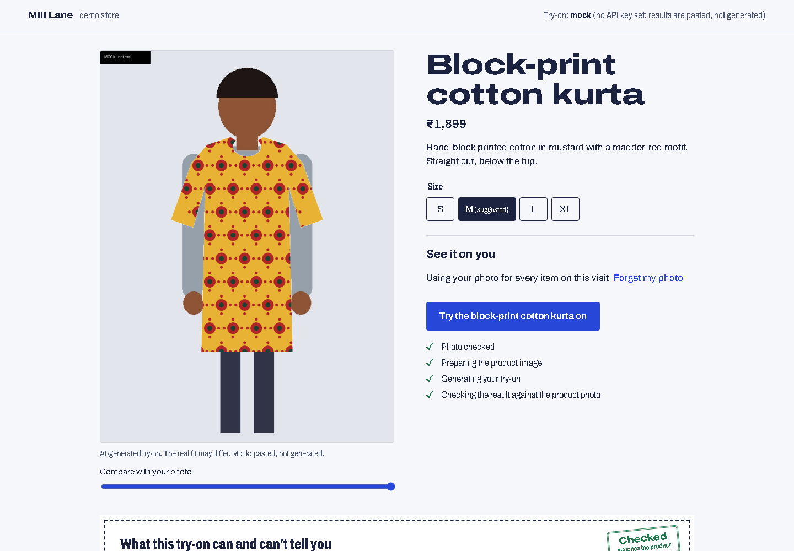

# Trusted try-on

[](https://github.com/thegoodengineers/trusted-tryon/actions/workflows/test.yml)

**See it on you, and know what the picture can't tell you.** A product page with a virtual try-on that
checks every result against the product photo before you see it, retries or holds back a result that
doesn't match, and answers "will it fit?" from the size chart instead of the picture.

Built for [HackTheFashion Global'26](https://hackthefashion-global26.devpost.com/), **Try-On Commerce** track,
by Chirag, Bhumika, Ayush and Abhijeet (The Good Engineers). Try-on by the
[Clothsy AI Try-on API](https://clothsyai.fabricvton.com/docs/api) from FabricVTON.



## Why it matters
- Shoppers return clothes when the item turns out different from what they expected. A try-on that
  shows the wrong colour, or looks like it fits when the size is wrong, adds to that problem.
- A try-on image is drawn by a model. It shows colour and style on you. It is not drawn to scale, so it
  can't show fit, and nobody tells the shopper that.
- So every result here comes with a **care label**: what we checked, what the picture can't tell you,
  how long it took, and a stamp: *Checked*, *Checked twice* (first try was off, retried) or *Held back*.

## For judges, start here
- **One click, no photo needed:** run it (below) and open `http://localhost:8790/?demo=1`. It uses our own
  drawn sample figure, runs a try-on, and fills in the size guide.
- **Works today without a key** on a clearly labelled mock (the page header says *mock*, every mock image is
  stamped "MOCK - not real"). Set `HTF_TRYON_API_KEY` and the same code calls the real API.
- **Tests:** 27 pytest tests, including the real-API client against a fake server that follows the documented
  contract (retry 429 with `Retry-After` and the same `Idempotency-Key`, no retry on 4xx, poll until done).
- **Accessibility:** 0 axe-core problems on our page, as first loaded and with a finished try-on, at 1440,
  1024 and 400 px (checked in CI with our own Ctrl+A11y tool).
- **Latency:** `results/LATENCY.md`, written only by `python bench.py`.

## How it uses the try-on API
All API calls live in [`tryon_client.py`](tryon_client.py).
1. **Before spending a credit**, the photo is checked here: readable, big enough, framing, light, blur.
   It's shrunk to 1600 px and re-saved, which removes location data. Nothing is sent without two ticks:
   18 or over and it's your photo; agree to processing.
2. `POST /images` uploads your photo **once per visit**; every garment reuses the id. Product images are
   uploaded once and their ids reused for 23 hours (they last 24).
3. `POST /tryons` with a fresh `Idempotency-Key`, `consent: true` and the product title; then
   `GET /tryons/{id}` every 2.5 s. Network errors, 429 and 5xx are retried with the same key (never charged
   twice), honouring `Retry-After`; 4xx are not retried.
4. **Fidelity check** on the result ([`checks.py`](checks.py)): the product's main colours (median-cut
   palette of the garment) must appear in the area that changed (CIE76 Delta E < 14 in CIELAB); the result
   must differ from your photo (the API can return your own photo when no garment was placed); and we look
   for the API's machine-readable AI label (IPTC `compositeWithTrainedAlgorithmicMedia`) in the file.
5. **One retry** if the colours don't match, keeping the better result. If it still fails, the result is
   *held back*: blurred, with an honest reason and a "Show it anyway" button.
6. Every documented error code becomes a plain sentence (`PERSON_PHOTO_REJECTED` -> "needs a clear photo of
   exactly one adult"; `INSUFFICIENT_CREDITS` -> try-on paused, size guide still works).
7. `GET /account` shows credits left in the header.
8. Same photo + same garment on one visit comes back from memory instantly.

## Fit from the size chart ([`fit.py`](fit.py))
Each product has a size chart and the room ("ease") it is designed to have at chest, waist and hip: a wrap
dress sits close, a denim jacket is roomy. We compare your measurements with every size, pick the one that
has the designed room for the most measurements, and say how sure we are: *high* (all of 2+ measurements
match), *medium* (only chest given), *low* (no size fits everything, and which measurement is off). The tape
under it shows where you land.

## Privacy and images
- Shopper photos and results live only in the server's memory for the visit (30 minutes, or **Forget my
  photo**). Never written to disk here. The API keeps uploads up to 35 days, then deletes them (its docs).
- Every result is captioned "AI-generated try-on. The real fit may differ." and its alt text says so.
- **Every image in this repo is our own drawing** ([`tools/make_assets.py`](tools/make_assets.py)): five
  product shots and two non-photoreal sample figures. No photos of real people. Font: Archivo (SIL OFL).

## Run it
```
git clone https://github.com/thegoodengineers/trusted-tryon.git
cd trusted-tryon
python -m pip install -r requirements.txt
python -m pytest -q
python -m uvicorn app:app --port 8790
```
Open http://localhost:8790 (or `/?demo=1`). For the real API, get a key (below) and before starting:
`$env:HTF_TRYON_API_KEY="clothsy_live_..."` (PowerShell) or `export HTF_TRYON_API_KEY=...`.

**Getting a key:** sign in at https://app.clothsyai.fabricvton.com/login, open **Developer API**, click
**Create API key** (shown once). New accounts get 20 free credits; one credit per finished try-on, failed
ones refunded. Never commit the key.

## Measuring latency
```
python bench.py            # mock: our pipeline only
python bench.py --real --n 1   # live API: each round tries 5 garments on 2 figures (up to 20 credits)
```
Appends to `results/latency.csv` (wall time, attempts, verdict, colour score, cached-repeat time, polls,
retries, commit, machine) and rewrites `results/LATENCY.md`.

## Known limits (honest status)
- **Not yet run against the live API**: we have no key in CI. The client follows the published docs and is
  tested against a fake server; real latency and real fidelity numbers come when `bench.py --real` runs.
- The colour check catches wrong colours and "nothing placed", not smeared prints or broken logos. The care
  label says so and asks the shopper to compare the zoom with the product photo.
- Thresholds (blur, light, Delta E) are set on our own images and a few phone photos, not a dataset.
- We can't verify age; we ask, and the API itself rejects photos that don't clearly show one adult.
- In-memory sessions: one server process. Fine for a demo; a real store would use a shared store.
- The mock makes the kurta's first try-on after each server start come back with wrong colours on purpose,
  so the retry path can be seen without a key.

## Layout
`app.py` web API and job runner · `tryon_client.py` Clothsy client and labelled mock · `checks.py` photo and
result checks · `fit.py` size guidance · `catalog.json` products and size charts · `static/` page ·
`bench.py` latency · `tests/` · `tools/` asset drawing and screenshots · `docs/` submission kit ·
`design/` references and vibe · `tasks/` who does what.

MIT licence.
